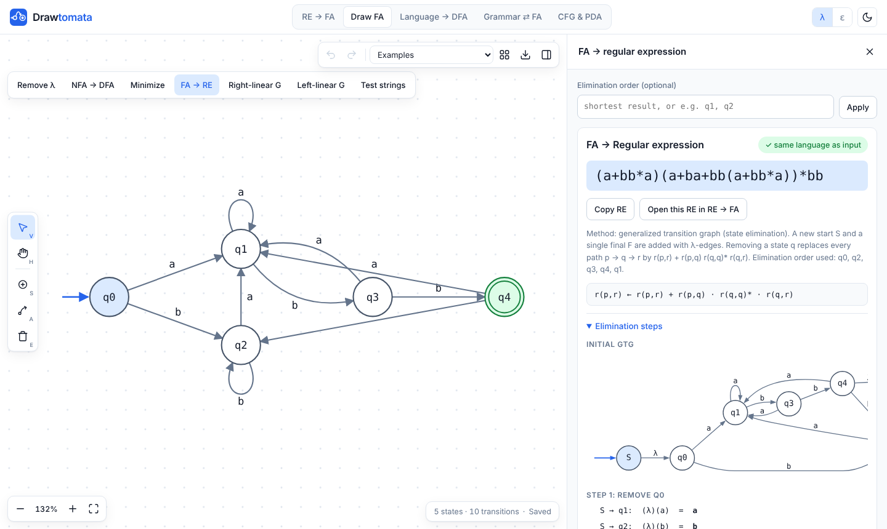

<p align="center">
  <picture>
    <source media="(prefers-color-scheme: dark)" srcset="assets/drawtomata-logo-dark.svg">
    
  </picture>
</p>

<p align="center">
  <a href="https://drawtomata.vercel.app/"><b>Open Drawtomata</b></a>
  &nbsp;·&nbsp;
  <a href="https://github.com/SlazzInC0de/drawtomata/actions/workflows/test.yml"></a>
</p>

Drawtomata converts between regular expressions, finite automata and grammars, and shows the working: closure tables, subset tables, the minimization table, state elimination steps, derivations. I built it because these conversions are easy to get wrong by hand in a TOC exam and hard to check.



## Features

**RE → FA.** Thompson construction to a λ-NFA, λ-closure method to an NFA, subset construction to a DFA, then minimization with both the mark (table-filling) procedure and the π-partition method.

**Draw FA.** Draw any DFA, NFA or λ-NFA on a canvas and run:
- remove λ-moves, NFA → DFA, minimize
- FA → RE by state elimination (tries elimination orders and keeps the shortest result, or uses yours)
- FA → right-linear and left-linear grammar
- string tests

The canvas has pan and zoom, undo/redo, autosave, auto-layout, and PNG / SVG / JSON export.

**Language → DFA.** Starts with, ends with, contains, count or length mod m, count or length compared to k, k-th symbol from the right. Conditions can be negated and combined with AND / OR (product construction).

**Grammar ⇄ FA.** Right-linear and left-linear grammars to NFA.

**CFG & PDA.** Leftmost and rightmost derivations, parse trees, an ambiguity search, the strings of L(G) up to a length, CFG → NPDA (GNF method or the general method) and an NPDA simulator that prints the instantaneous descriptions.

**Parsing.** For any context-free grammar:
- FIRST and FOLLOW sets, with the passes that built them
- left recursion removal (direct and indirect) and left factoring
- LL(1) predictive parsing table with conflicts explained, the non-recursive parse trace, and recursive descent procedures with a call trace
- LR(0) items and automaton, SLR(1), canonical LR(1) and LALR(1) tables, with a shift-reduce trace for any input
- yacc-style `%left` / `%right` declarations to resolve conflicts, an operator precedence parser, and rewriting an ambiguous expression grammar into an unambiguous one

Every result is checked against its input for language equivalence before it is shown. The ambiguity search is bounded, so "none found" is evidence, not a proof.

Notation follows Peter Linz for automata and Aho, Lam, Sethi and Ullman for parsing, *An Introduction to Formal Languages and Automata*.

## Input format

| What | Example |
| --- | --- |
| Regular expression | `(a+b)*abb` with `+` union, `*` star, `λ`/`ε`/`@` empty string, `∅` empty set |
| Grammar | `S -> aSb \| λ` one production per line; variables are capitals like `S` or `A1` |
| Parsing grammar | `E -> E + T \| T`, `F -> ( E ) \| id`; words like `id`, `if`, `num` are single terminals |
| Precedence | `%left + -` then `%left * /`, lowest precedence first |
| NPDA | `δ(q0, a, z) = {(q0, az), (q1, λ)}` with the stack top written first |

## Keyboard (Draw FA)

| Key | Action |
| --- | --- |
| `V` / `H` / `S` / `A` / `E` | select, pan, state, transition, erase |
| double-click | add a state, or rename one |
| `Delete` | delete the selection |
| `Ctrl+Z` / `Ctrl+Shift+Z` | undo / redo |
| `F`, `+`, `-`, `0` | fit, zoom in, zoom out, 100% |
| `Space` + drag | pan |

## Running it

There is no build step. Open `index.html`, or serve the folder:

```
npm start        # python3 -m http.server 8000
npm test         # node tests/run.js
```

Diagrams use [viz.js](https://github.com/mdaines/viz-js) (Graphviz in WebAssembly) from jsDelivr, with a plain SVG layout as fallback.

To deploy, push the folder to GitHub and enable Pages on the root of `main`, or import the repo into Vercel or Netlify with no build command.

## Layout

```
index.html
css/style.css
js/regex.js      RE parser and simplification rules
js/automata.js   Thompson, λ-removal, subset, minimization, state elimination, products
js/grammar.js    grammar parsing, CFG derivations, ambiguity, NPDA
js/parsing.js    FIRST/FOLLOW, LL(1), recursive descent, LR(0)/SLR/CLR/LALR, precedence
js/render.js     diagrams and tables
js/editor.js     the drawing canvas
js/app.js        page wiring
tests/run.js     conversion tests
```

## Roadmap

| Release | Adds |
| --- | --- |
| 21 Oct 2026 | Parsing: FIRST/FOLLOW, left recursion, left factoring, LL(1), recursive descent, LR(0), SLR, CLR, LALR, precedence |
| 23 Oct 2026 | Pumping lemma helper, PDA → CFG, grammar simplification and CNF |
| 25 Oct 2026 | Code generation: DAGs, three-address code, quadruples/triples, basic blocks, flow graphs, peephole |
| 27 Oct 2026 | Syntax-directed translation: annotated parse trees, dependency graphs, S/L-attributed checks |
| 29 Oct 2026 | Lexical analysis: token recognition, lexer playground, input buffering, Lex/Yacc specs |

## License

MIT
